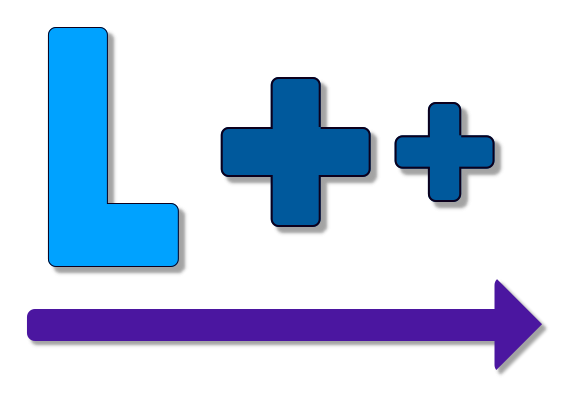

# L++ — Made to be enjoyed
<p align="center">
  
</p>
L++ is a strongly and statically typed programming language
compiled using LLVM, with its compiler written entirely in TypeScript.

It's inspired by Luau and C++ hence the name L++

It follows a simple philosophy:

> **Programming should be easy and enjoyable.**

## Prerequisites
To use or install the L++ compiler/toolchain you'll need these tools:
- Node.js 24 or later
- Git
- LLVM and Clang

  
To install Node.js go to the [installation page](https://nodejs.org/en/download) and follow the instructions.
Do the same for [Git](https://git-scm.com/install/).\
to install the LLVM toolchain and clang you'll need to use your package manager, here are some examples:
### Windows


#### Winget
```bash
winget install LLVM.LLVM
```
#### Chocolatey
```bash
choco install llvm
```

### macOS
```bash
brew install llvm
```
since brew marks llvm as keg-only you may need to add `$(brew --prefix llvm)/bin` to your PATH


### Linux


#### Fedora/RHEL/Alma Linux
```bash
sudo dnf --refresh install llvm clang
```
#### Arch Linux
```bash
sudo pacman -Syu llvm clang
```
#### Ubuntu/Debian/Linux Mint/Pop!_OS/Kali Linux 
```bash
sudo apt update
sudo apt install llvm clang
```
#### Void Linux
```bash
sudo xbps-install -S llvm clang
```
#### openSUSE
```bash
sudo zypper refresh
sudo zypper install llvm clang
```
#### Alpine Linux
I'm not quite familiar with Alpine Linux but from what I know you should check what version of Alpine you have and what llvm and clang versions it has.
for Alpine 3.22
```bash
sudo apk add llvm20 clang20
```
#### Gentoo Linux
```bash
sudo emerge --sync
sudo emerge --ask llvm-core/llvm llvm-core/clang
```
#### NixOS
Add the packages to your configuration:
```nix
environment.systemPackages = with pkgs; [
    llvmPackages.llvm
    llvmPackages.clang
];
```
then apply:
```bash
sudo nixos-rebuild switch
```

After installing the required packages, verify that they are available:
```bash
node --version
git --version
clang --version
llvm-as --version
```
## Installation
Once you've installed Git, Node.js and the LLVM toolchain you'll have to clone the repo:
```bash
git clone https://github.com/silliestbiddlebuddy-dotcom/LPP-lang/ lpp
cd lpp
```
Install the project's dependencies: 
```bash
npm install
```
You can optionally check dependency funding information and audit reports:
```bash
npm fund
npm audit
```

If an audit reports vulnerabilities, review the report before deciding whether to run `npm audit fix`.\
Link the CLI globally so that the lpp command can be used from any directory:
```
npm link
```
If `npm link` fails with an `EACCES` permission error, your npm
global installation directory may not be writable.

One solution is to configure a user-owned npm prefix:

```bash
mkdir -p ~/.npm-global
npm config set prefix ~/.npm-global
```

Add the following to your shell configuration:

```bash
export PATH="$HOME/.npm-global/bin:$PATH"
```

Restart your terminal or reload your shell configuration.

## Usage
The following table lists the available CLI commands.
| Command | Description |
|---|---|
| `lpp build <directory> [options]` | Builds all `.lpp` files in a directory. |
| `lpp compile <file.lpp> [options]` | Compiles a single `.lpp` source file. |
| `lpp compileToLLVM <file.lpp> [options]` | Generates LLVM IR from a single `.lpp` source file. |
| `lpp compileLLVM <files...> [options]` | Compiles one or more LLVM files into executables. |
| `lpp init-config [directory] [options]` | Creates an LppConfig.jsonc configuration file. |


For a complete list of CLI options, see [CLIOptions.md](docs/CLIOptions.md).
## Examples

See the [Examples directory](Examples/) for additional programs.\
### Variables:
```lpp
const local myConstNumber: int32 = 0;
local myNumber: int32 = 0;
myConstNumber = 2; // Error
myNumber = 4; // Valid
myNumber = 3.14; // Error
```


### Functions and generics: 
```lpp
function tryToAdd<T: any>(a1: T, a2: T): T {
  // if you can't  add these two elements it will error out, which means this should return T 
  return a1 + a2;
}
// Generics are experimental.
// Type inference is not implemented yet.
// Generic calls may therefore not be fully type-checked.
// Their behaviour may change in future releases.
// local num: int32 = 0;
// num = tryToAdd("string", 2.3); (this would work)

```


### Type Aliases: 
```lpp
// they also support generics
type myCoolType = int32;
type myOtherCoolType = float32;

const local myNum: myCoolType = 0;
const local myOtherNum: myOtherCoolType = 0.5;
const local result: int32 = myNum + myOtherNum; // Error, you can't add an integer to a floating point number
```


### UDTs (User Defined Types):
```lpp
// they also support generics
type myCoolType = {
  myNum: int32,
  myString: string
};
const local myCoolObject: myCoolType = {}; // Error
```


### Interfaces:
```lpp
// they also support generics
interface myCoolInterface {
  iDontReallyKnow: int32; // (;) not needed but it's good practice
}
const local myCoolObject: myCoolInterface = {}; // Error
```


### While Loops:
```lpp
local myNum: int32 = 0;
while (myNum < 100) do {
  myNum += 1;
}
```


### For Loops:
```lpp
for (local myNum: int32 = 0; myNum < 100; myNum += 1) do {
  // do stuff
}
```


### Classes: 
```lpp
class myClass {
  private myNum: int32
  public function myClass(num: int32): myClass {
    this.myNum = num;
    return this
  }
}
```
## Compiler Architecture
The compiler is written in TypeScript and uses an LLVM backend.

The compiler pipeline consists of several stages:
| Stage | Description |
|---|---|
| Lexing | Converts source code into tokens. |
| Parsing | Builds an Abstract Syntax Tree (AST). |
| Binding | Resolves identifiers and establishes scopes. |
| Module Resolution | Resolves imported modules and dependencies. |
| Type Checking | Validates expressions, statements, and type compatibility. |
| Code Generation | Translates the typed program into LLVM IR. |

The project is currently under development, and some features are incomplete.

## Project Status

L++ is currently under active development.

Some features are experimental or incomplete, and language
syntax and compiler behaviour may change between releases.

## FAQ
Q: What is L++?
> L++ is a statically compiled language
Q: Is L++ Compiled or Interpreted?
> L++ is compiled however in the future it may also be interpreted
Q: Is L++ open source?
>L++'s source code is publicly available for viewing. However, its license does not permit modification or redistribution **for now**
Q: Is L++ suitable for beginners?
> I'd say yes, L++ syntax is readable, it teaches you types, memory management, how to use CLIs... 
Q: What platforms does L++ support?
> Any platform supported by the required LLVM/Clang toolchain, provided the L++ runtime supports it.
Q: Why is the compiler written in TypeScript?
> Not many languages are written in it, and it was the language i knew best
Q: Does L++ compile directly to machine code?
> No L++ compiles to LLVM IR and then uses Clang to compile it into native machine code
Q: Why does L++ require explicit type annotations?
> It's easier for me to do type-checking and predictability for users
Q: Why doesn't L++ have pointers?
> So beginners don't have to learn references or dereferences directly, tho manual memory management will make it easier for them to understand them
Q: How can I report a bug?
> Open an issue and prefix it with "Bug: " in the title
Q: Can I contribute to the compiler?
> Not Yet
Q: How can I propose a language feature?
> Open an issue and prefix it with "Feature Suggestion: " in the title
Q: How do I update L++?
> Run `lpp update`
Q: Can I write native code for L++?
> Not right now, eventually yes. once i finish the module system and backend i'll work on interoperability
Q: How does L++ handle the standard library?
> We have a folder named `std` and inside there's the libraries you import (math, io...),
> Inside each one of them there are 3 files: `.h`, `.c` and `.lpp` file (eventually a `.ll` file too)
> `.h` serves so the compiler can generate LLVM IR declarations
> `.c` serves as the actual implementation
> `.lpp` serves as L++ declarations for the typechecker

## License

L++ is distributed under the [LICENSE](LICENSE).
